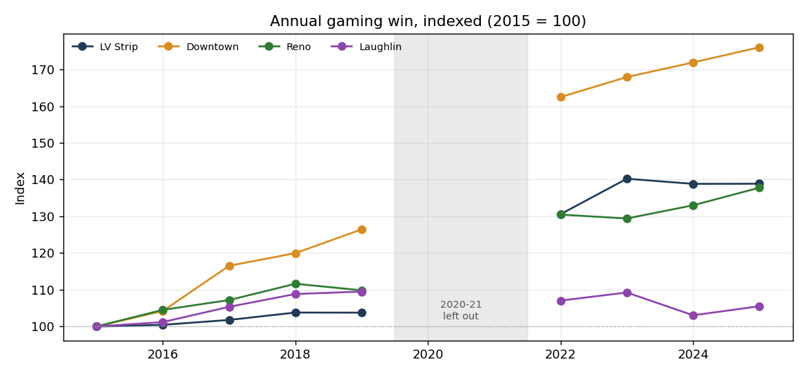
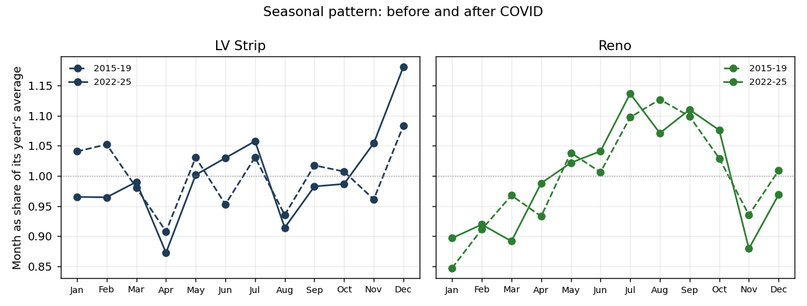
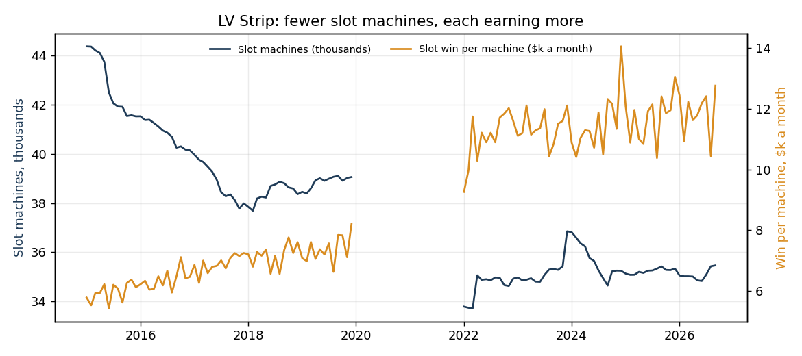
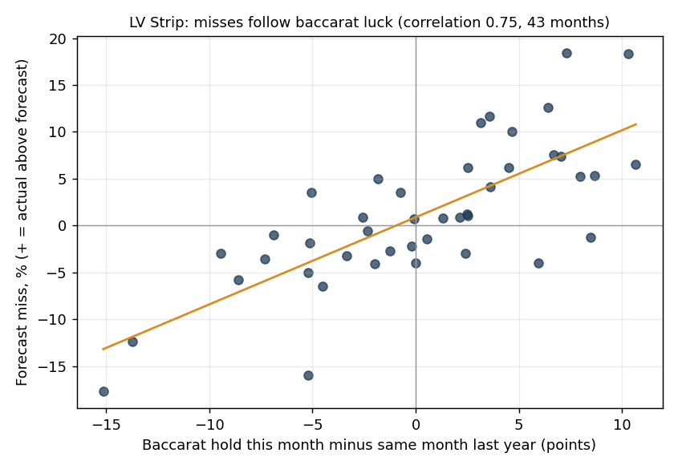

# Exploratory analysis: Nevada gaming win, 2015 to 2026

**Updated 13 November 2026.** It replaces the first version, which covered 2022 onward only.

- **Data:** `data/clean/monthly_win.csv` (newest figure for each month, D9) and `data/clean/capacity_hold_monthly.csv` (tables, machines, hold).
- **Period:** January 2015 to September 2026. 2020 and 2021 are left out (D23).
- **Markets:** LV Strip, Downtown, Reno, Laughlin.
- **Charts:** `docs/charts/`, made by `scripts/eda_charts.py`.

## Summary

| # | Finding | Why it matters for the product |
|---|---|---|
| 1 | Every market except Laughlin reset about 25–40% higher after COVID | Pre-COVID years are a different level. Models must not treat 2015–19 as "normal" for size |
| 2 | Since 2023, growth has nearly stopped (Strip flat), apart from Reno | "Same month last year" works well in a flat market. That's why it's hard to beat |
| 3 | The seasonal pattern changed: the Strip's December peak is stronger, and January–February are weaker | Older seasons mislead. This supports retraining (D39) |
| 4 | Fewer machines and tables, but each earns far more | Capacity changes are real. That's why there's a capacity alert (D37) |
| 5 | Strip forecast misses follow baccarat luck (correlation 0.75) | Much of the Strip's error can't be forecast. Set expectations accordingly |
| 6 | Small markets are noisier (Downtown 18%, Laughlin 16% month-to-month) | Wider ranges for the new markets (D29) |
| 7 | Laughlin is shrinking. Downtown is growing fastest | Different stories per market, so a per-market rule is needed (D32) |

## 1. A higher level after COVID

| Market | 2015 ($m) | 2019 ($m) | 2025 ($m) | 2025 vs 2019 | Share of state, 2015 → 2025 |
|---|---|---|---|---|---|
| Statewide | 11,115 | 12,031 | 15,801 | **+31%** | — |
| LV Strip | 6,348 | 6,587 | 8,815 | +34% | 57.1% → 55.8% |
| Downtown | 542 | 685 | 954 | **+39%** | 4.9% → 6.0% |
| Reno | 571 | 627 | 786 | +25% | 5.1% → 5.0% |
| Laughlin | 468 | 512 | 494 | **−4%** | 4.2% → 3.1% |

From 2015 to 2019 growth was slow, at 1–6% a year. After reopening, every market except Laughlin came back 25–40% bigger. This was a step change, not steady growth.

## 2. Growth has stalled since 2023, except in Reno

- **Strip:** $8.9bn in 2023, then $8.8bn in both 2024 and 2025.
- **Jan–Sep 2026 against the same months of 2025:**
  - Statewide: +2.7%
  - Strip: +2.7%
  - Reno: **+8.0%**
  - Downtown: −0.9%
  - Laughlin: −1.3%
- **Reno's growth** is why "same month last year" keeps forecasting it too low (too low in 28 of 43 test months).

## 3. The seasonal pattern has shifted

Each month as a share of its year's average:

| Market, month | 2015–19 | 2022–25 |
|---|---|---|
| Strip, December | 1.08 | **1.18** |
| Strip, January | 1.04 | **0.97** |
| Strip, February | 1.05 | **0.96** |
| Strip, April (lowest) | 0.91 | 0.87 |
| Reno, July to September (summer peak) | 1.10–1.13 | 1.07–1.14 |
| Reno, November (dip) | 0.94 | 0.88 |

The Strip now depends more on December and less on early-year events. A model that learns seasons from 2015–19 will be partly wrong. That's one reason the Strip models improved with monthly retraining (D39).

## 4. Less capacity, more productivity

| Market | Tables, 2015 → 2026 | Slot machines, 2015 → 2026 | Slot win per machine ($k a month), 2015 → 2025 | Tables' share of win, 2015 → 2025 |
|---|---|---|---|---|
| LV Strip | 2,834 → 2,495 | 44,370 → 35,466 (−20%) | 6.0 → **11.7** | 51% → 44% |
| Reno | 425 → 293 | 11,467 → 8,893 (−22%) | 3.3 → 6.1 | 22% → 18% |
| Downtown | 419 → 355 | 10,462 → 9,840 (−6%) | 3.1 → 5.2 | 28% → 33% |
| Laughlin | 194 → 128 | 7,689 → 5,757 (−25%) | 4.5 → 6.6 | 11% → 8% |

Casinos run fewer, higher-earning machines. On the Strip, slots now bring in a larger share than tables. Sudden capacity changes, such as closures, are what the capacity alert watches for.

Note: the venue count isn't comparable across 2018, when the Board's report changed from "locations" to "licensees" (D30).

## 5. Strip misses follow baccarat luck

- **"Hold"** is the share of money bet that the casino keeps. For high-stakes baccarat it swings widely, from 7% to 27% a month on the Strip.
- **Why it causes misses:** "same month last year" copies last year's luck. When this year's hold is higher, the forecast comes out too low, and the other way round.
- **How strong the link is:** across the 43 test months, the forecast miss and the change in baccarat hold have a **correlation of 0.75**. For Reno, where tables matter less, it's 0.36.
- **The limit:** hold is only known after the month ends, so it **explains** misses but can't be used to forecast them.
- **For the product:** much of the Strip's error is luck, not model weakness. A future option is to forecast the amount bet, which is steadier, and apply a normal hold to it.

## 6. Volatility: how much a month moves from the month before

| Market | 2015–19 | 2022–26 |
|---|---|---|
| LV Strip | 11.8% | 11.6% |
| Reno | 10.4% | 11.9% |
| Downtown | 15.1% | **18.4%** |
| Laughlin | 16.6% | 16.0% |

The Strip is as volatile as before COVID. Downtown has become noisier. Downtown and Laughlin forecasts will need wider ranges.

## 7. The four markets tell different stories

| Market | Story |
|---|---|
| LV Strip | The biggest market. Back at a higher level, but flat since 2023. Errors driven by baccarat luck |
| Downtown | Fastest growth since 2015 (+76% on 2015), but noisier |
| Reno | Steady growth, still rising in 2026, so it's under-forecast by a simple rule |
| Laughlin | Shrinking: −4% on 2019, with a quarter of its machines gone |

## Data checks for this analysis

- No zero or negative values. All 20 areas are present in all 117 months.
- Figures are the newest published (D9). The last 12 months, and 2019, may still be revised.
